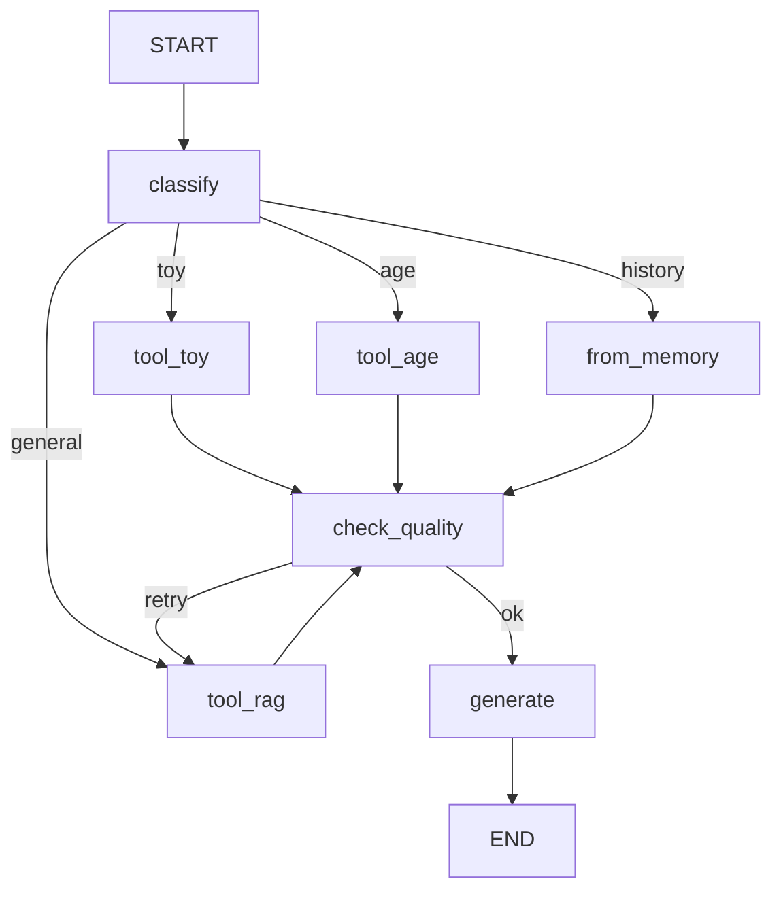

# Architecture

## Обзор системы

```
Пользователь
    │
    ▼
┌─────────────────────────────────┐
│         Gradio UI (app.py)      │
│   текстовый ввод / аудио ввод   │
└────────────────┬────────────────┘
                 │
                 ▼
┌─────────────────────────────────┐
│      pipeline_ui.py             │
│  ┌─────┐  ┌──────────┐  ┌────┐ │
│  │ ASR │→ │ Workflow │→ │TTS │ │
│  └─────┘  └──────────┘  └────┘ │
│  Whisper   LangGraph    Minimax │
│  fal.ai                fal.ai  │
└────────────────┬────────────────┘
                 │
                 ▼
┌─────────────────────────────────────────────────────────┐
│                  workflow.py (LangGraph)                 │
│                                                         │
│   ┌──────────┐                                          │
│   │ classify │ ── toy ──→ get_toy_info()                │
│   └──────────┘ ── age ──→ get_age_recommendations()     │
│                ── general → search_posts() (RAG)        │
│                ── history → from_memory()               │
│                                                         │
│   ┌───────────────┐     ┌──────────┐                   │
│   │ check_quality │─ ok→│ generate │                   │
│   └───────────────┘     └──────────┘                   │
│           │ retry                                       │
│           └──────────────────────────┐                  │
│                                      ▼                  │
│                              повторный поиск            │
└─────────────────────────────────────────────────────────┘
                 │
                 ▼
┌─────────────────────────────────────────────────────────┐
│                   RAG Pipeline                          │
│                                                         │
│  ┌────────────────┐    ┌───────────────────────────┐   │
│  │ Query Rewriting│    │  Hybrid Retrieve           │   │
│  │ (3 варианта)   │───→│  Dense (ChromaDB) + BM25   │   │
│  └────────────────┘    │  RRF (k=60)               │   │
│                        └──────────────┬────────────┘   │
│                                       │                 │
│                        ┌─────────────▼────────────┐    │
│                        │  CrossEncoder Reranker    │    │
│                        │  BAAI/bge-reranker-v2-m3  │    │
│                        └─────────────┬────────────┘    │
│                                       │                 │
│                        ┌─────────────▼────────────┐    │
│                        │  generate_answer()         │    │
│                        │  gpt-4o-mini + memory      │    │
│                        └───────────────────────────┘    │
└─────────────────────────────────────────────────────────┘
```

## Компоненты

### Данные и индексация

| Компонент | Описание |
|---|---|
| `instagram_scraper3.py` | Playwright-скрапер с авторизацией — обходит профили, сохраняет текст постов и URL изображений в JSON |
| EasyOCR | Извлечение текста из изображений-слайдов (русский + английский) — результат добавляется к тексту поста |
| `data_loader.py` | Загрузка Instagram JSON, фильтрация пустых постов |
| `chunkers.py` | Naive chunking (1024 tok, overlap 200) + Semantic chunking (1000 tok, overlap 150) |
| `retrieval.py` | ChromaDB (persistent), BM25, Dense retrieve, RRF fusion, generate_answer |
| `reranker.py` | CrossEncoder reranking, Query Rewriting (3 варианта через GPT) |

### Оркестрация

| Компонент | Описание |
|---|---|
| `workflow.py` | LangGraph StateGraph — classify → branch → check_quality → generate |
| `pipeline_ui.py` | Оркестратор Gradio-запросов, Langfuse трейсинг |
| `memory.py` | ConversationSummaryBufferMemory (max 1000 токенов) |

### Интерфейс

| Компонент | Описание |
|---|---|
| `app.py` | Gradio UI — текстовый и голосовой ввод, вывод ответа + аудио |
| `chat.py` | Терминальный чат |
| `main.py` | CLI точка входа (--chat, --batch, --both) |

### Интеграция

| Компонент | Описание |
|---|---|
| `mcp_server.py` | FastMCP-сервер, 3 tool-а для внешних AI-агентов |
| `skills/child-dev-rag/SKILL.md` | Agent Skill по стандарту agentskills.io |
| `voice/tts.py` | Minimax TTS через fal.ai API |

## LangGraph Workflow



**Узлы:**
- `classify` — GPT определяет тип запроса (toy / age / general / history)
- `tool_toy` — `get_toy_info()` из MCP-сервера
- `tool_age` — `get_age_recommendations()` из MCP-сервера
- `tool_rag` — полный Hybrid+Rerank+QR поиск
- `from_memory` — ответ из истории диалога
- `check_quality` — GPT оценивает достаточность контекста
- `generate` — финальный ответ с учётом памяти диалога

## Параметры системы

| Параметр | Значение | Обоснование |
|---|---|---|
| Embedding model | `intfloat/multilingual-e5-large` | Многоязычная модель, поддерживает русский |
| Reranker | `BAAI/bge-reranker-v2-m3` | Лучший open-source CrossEncoder для русского |
| LLM | `gpt-4o-mini` | Баланс качества и стоимости |
| Chunk size (naive) | 1024 токена, overlap 200 | Стандарт для длинных постов |
| Chunk size (semantic) | 1000 токена, overlap 150 | Семантические границы |
| Dense top-k | 5 | Достаточно для контекста |
| Rerank pool | 15 | Широкий охват перед финальным отбором |
| RRF k | 60 | Стандартное значение для fusion |
| QR variants | 3 | Три переформулировки запроса |
| Memory limit | 1000 токенов | Баланс контекста и стоимости |

## Трейсинг

Каждый Gradio-запрос трейсится в **Langfuse** со структурой:

```
ui-request
  ├── asr       (Whisper: audio → text)
  ├── workflow  (LangGraph: question → answer)
  └── tts       (Minimax: text → mp3)
```

Дашборд: [cloud.langfuse.com](https://cloud.langfuse.com)
